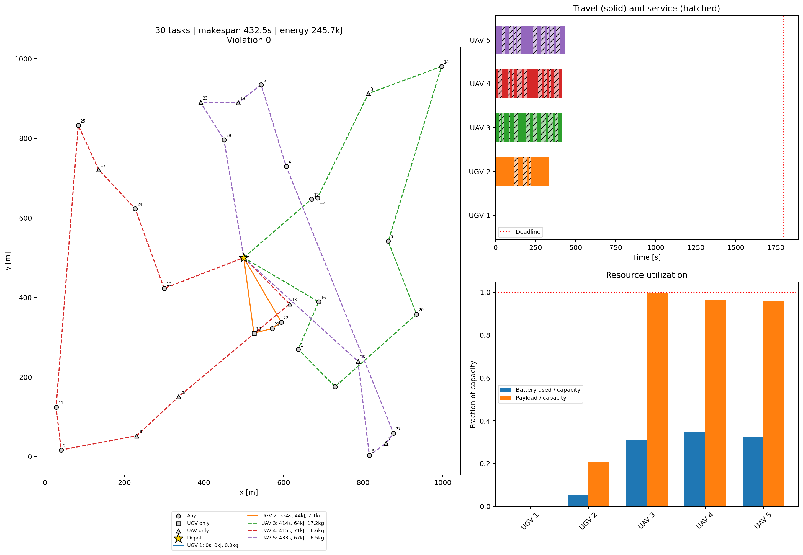
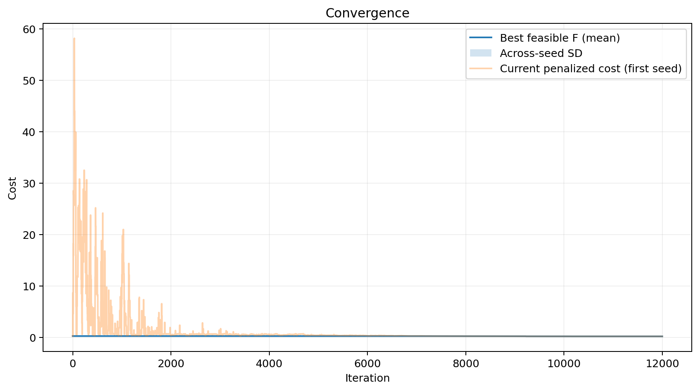
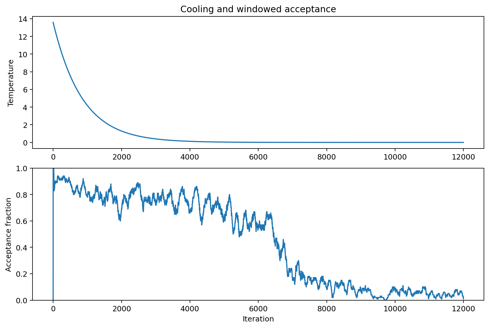
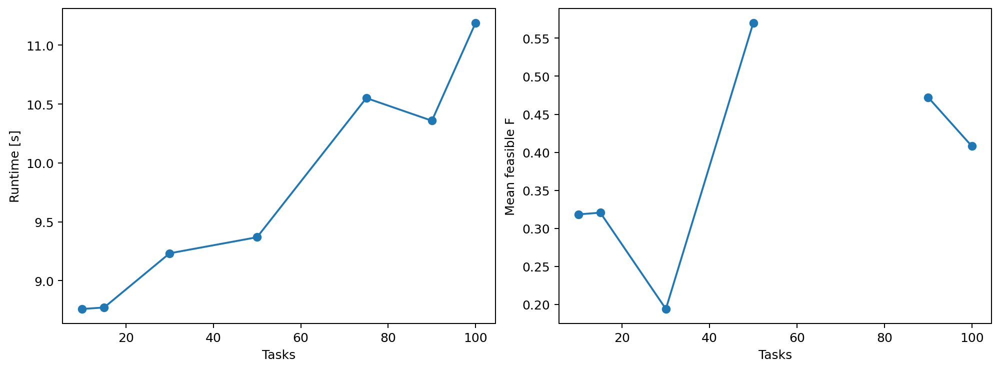

# Heterogeneous UAV–UGV cooperative task allocation and routing

MCTR 1021, German University in Cairo — Team 10. The Milestone 2 random-key model
is preserved, with a Milestone 3 simulated annealing solver and reproducible
validation, case studies and parameter analysis. NumPy and Matplotlib are the
only direct dependencies.

Read [HOW_TO_RUN.md](HOW_TO_RUN.md), [algorithm details](docs/sa_description.md),
[report checks](docs/report_fixes.md), and [CHANGELOG.md](CHANGELOG.md).

| File | Purpose |
|---|---|
| [instance.py](instance.py) | Fixed model data and seeded generator |
| [fitness.py](fitness.py) | Decoding, constraints and GA/PSO/SA objectives |
| [sa.py](sa.py) | Configuration, encoding, construction and public interface |
| [sa_engine.py](sa_engine.py) | Cached route states and annealing chains |
| [run_sa.py](run_sa.py) | Single reproducible run |
| [run_cases.py](run_cases.py) | Seven scale/constraint studies |
| [parameter_study.py](parameter_study.py) | OFAT, ablations, factorial grid and trade-offs |
| [experiments.py](experiments.py) | Measurement and persistence helpers |
| [visualize.py](visualize.py) | Headless figures and snapshots |
| [validation/](validation/) | Exact solver, baselines, CVRP fixture and speed replay |
| [tests/](tests/) | Standard-library regression suite |

## Figure gallery

Results concern these instances and budgets, not universal SA superiority.
CVRP data are explicitly synthetic; literature labels denote scale matching only.
