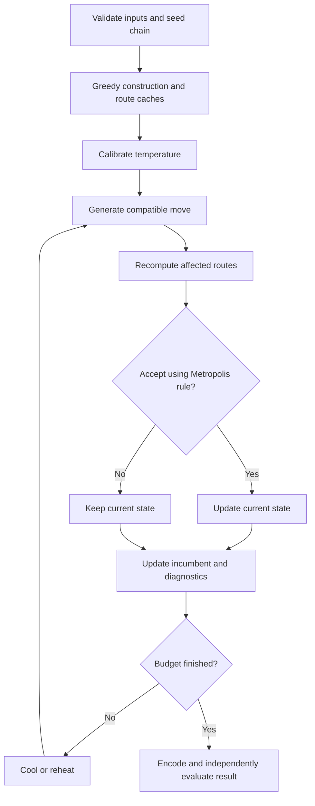

# Simulated annealing for cooperative task routing

The optimizer minimizes the report's dimensionless objective
`F = alpha * max(T_k) / T_max + (1-alpha) * sum(E_k) / sum(B_k)`.
Route distance includes both depot legs. `T_k = D_k/v_k + sum(service_i)`;
`E_k = e_k D_k`. The four normalized nonnegative violations are summed.
Search cost is `F + lambda * violation`. An additive penalty puts resource
excess on a common dimensionless scale without multiplying a violation by
an objective that can be near zero. It does not prove feasibility or optimality.

## Pseudocode

```text
for each independently seeded chain:
    construct several capability-compatible greedy solutions
    choose feasible minimum-F start, otherwise least-violating start
    cache distance, time, energy, load and capability per vehicle
    sample neighbor cost differences; T0 = mean(abs(delta)) / -log(target)
    keep a separate feasible incumbent and least-violating fallback
    repeat iterations times:
        choose a neighborhood; retry failed proposals using other neighborhoods
        copy and recompute only affected vehicle routes
        accept if delta <= 0, otherwise with probability exp(-delta / T)
        retain any better feasible proposal, even if not accepted as current
        optionally increase penalty after sustained infeasibility
        cool geometrically; optionally reheat from the incumbent on stagnation
        record objective, penalized cost, temperature and acceptance history
    encode the selected route solution as random keys
    independently verify it using evaluate()
return best feasible chain outcome, otherwise least-violating outcome
```



## Neighborhoods

All inter-vehicle operations check capabilities; payload, battery and deadline
remain soft constraints during search. Task ids occur exactly once.

| Operator | Example | Purpose |
|---|---|---|
| relocate | `[1,2], [3] -> [1], [3,2]` | Rebalance allocation |
| swap | `[1,2], [3,4] -> [1,4], [3,2]` | Exchange tasks across vehicles |
| two_opt | `[1,2,3,4] -> [1,3,2,4]` | Reverse a route segment |
| intra_swap | `[1,2,3,4] -> [4,2,3,1]` | Exchange two positions |
| or_opt | `[1,2,3], [4] -> [1], [4,3,2]` | Move 1–3 consecutive tasks, optionally reversed; within or across routes |

Uniform selection is the default. Adaptive selection uses the most recent
100 improving/accepted outcomes per operator with a positive exploration floor.
Attempt statistics include unsuccessful proposal draws; accepted moves exclude
identity moves. Up to eight draws per operator are tried before moving on.
An exhausted retry iteration is logged and counted, not accepted as a move.

## Parameters

| Parameter | Default | Meaning / rationale |
|---|---:|---|
| iterations | 12000 | Search proposals per independent chain |
| initial_temperature | automatic | Cost-scale-aware calibration; optional manual positive value |
| calibration_samples | 200 | Sample absolute cost differences at the initial solution |
| target_acceptance | 0.8 | Acceptance of an average absolute cost increase; not a guarantee of measured acceptance |
| final_temperature | 0.00001 | Low final uphill acceptance |
| derive_cooling | true | Reach final temperature at the last proposal |
| cooling_rate | 0.9995 | Used when derived cooling is disabled |
| penalty | 100 | Additive dimensionless resource violation weight |
| alpha | 0.5 | Equal normalized time/energy weight |
| construction_restarts | 100 | Greedy initial candidates; experiment CLIs default to 10 and record this |
| operators | all five | Diverse allocation and ordering moves |
| adaptive_operators | false | Optional recent-success weighting |
| adaptive_penalty | false | Double lambda after sustained infeasibility, capped at 1e12 |
| stagnation_window | 1000 | Reheating / penalty adaptation window |
| reheat | false | Reset current to incumbent and temperature to T0 |
| n_restarts | 1 | Independent SeedSequence child streams |
| acceptance_window | 100 | Rolling acceptance fraction |
| hill_climbing | false | Zero-temperature acceptance without invalid zero SA temperature |

Histories and operator statistics describe the selected chain; evaluations and
wall time aggregate all chains. Best feasible history is NaN before feasibility;
it must not be plotted as a feasible objective. Random-key allocation keys sit
at vehicle-bin centers; unique sequence ranks preserve each route's ordering.

## Complexity and accounting

Distance matrices require O(n²) memory. A cached move costs O(m + L_a + L_b)
for affected route lengths, including copied route lists and metrics; global
max time and summed constraints require O(m). It is not a constant-time edge
delta implementation. Cross-vehicle swap candidate generation may scan O(n)
tasks. Insertion construction uses vectorized edge deltas and costs O(n² + nm)
per start. Histories require O(n_restarts * iterations) peak memory because all chain results
are retained until winner selection; each chain keeps five route snapshots.

Exact validation enumerates subset tours (factorial in n), then subset partitions;
it is intentionally limited to n <= 9. Shortest ordering dominates other orderings
for a fixed vehicle/subset because all resources and objectives are monotone in
distance. Baseline evaluation budgets count complete candidate solutions;
partial greedy insertion scores are excluded and runtime is reported separately.
This is evaluation-budget matching, not CPU-budget matching.
